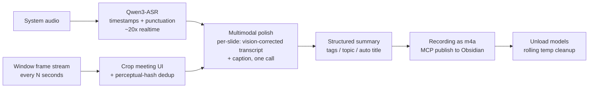

# meeting-to-obsidian

[](LICENSE)
-black)
[](https://www.python.org)

Turn online meetings (Tencent Meeting / WeMeet, or any on-screen meeting app) into structured
**Obsidian notes** — automatically, fully local, on Apple Silicon.

**中文说明：[README.zh-CN.md](README.zh-CN.md)**

## What it does



- **Occlusion-immune capture** — a persistent SCStream subscribes to the meeting window's video
  output (not screen screenshots), so other windows in front don't matter. Native Retina
  resolution, built-in per-frame MD5 dedup.
- **System audio, not microphone** — records what the meeting app plays (ScreenCaptureKit),
  everyone can keep using their speakers.
- **One ASR model** — Qwen3-ASR-1.7B (MLX) outputs the transcript, punctuation and per-sentence
  timestamps in a single pass (~20x realtime). whisper-large-v3-turbo is kept as a fallback.
- **Multimodal polishing** — each keyframe + the speech of its time window goes to a local
  vision-language model (Qwen3.6-35B-A3B via MLX server) in one call: slide text is used to fix
  ASR term errors, and a direct-statement caption is written per slide.
- **Clean output** — kepano-style note with frontmatter (topic / duration / tags / authors /
  recording link), image-text sections, structured summary; recording attached as 64k AAC;
  content-based note naming; models unloaded and temp files (≤1 GB) cleaned after each run.

## Requirements

- macOS on Apple Silicon (M1+), tested on M4 Pro
- Xcode command line tools (`swiftc`)
- Python 3.10+, `ffmpeg` (`brew install ffmpeg`)
- [Obsidian](https://obsidian.md) vault + the
  [Local REST API](https://github.com/coddingtonbear/obsidian-local-rest-api) style MCP endpoint
  used by `scripts/obsidian_mcp_client.py`
- Optional fallback backend: [ollama](https://ollama.com) with `qwen2.5:7b`

## Quick start

```sh
git clone https://github.com/fbica2gh/meeting-to-obsidian.git
cd meeting-to-obsidian
./install.sh
```

`install.sh` scaffolds your config (`~/.zcode/config/meeting-to-obsidian/`), builds the Swift
helpers, creates a Python venv with MLX dependencies, and prints the model download commands.

Then edit `~/.zcode/config/meeting-to-obsidian/config.sh` (vault path etc.) and start recording:

```sh
WID=$(swift scripts/find_tencent_window.swift)
SESSION="$HOME/Meetings/$(date +%Y-%m-%d_%H%M%S)"; mkdir -p "$SESSION"

scripts/system_audio_capture "$SESSION/audio.wav" &
echo $! > "$SESSION/audio.pid"
nohup bash -c 'while true; do W=$(swift scripts/find_tencent_window.swift); \
  scripts/window_stream "$W" '"$SESSION"' 5; sleep 2; done' &
echo $! > "$SESSION/screenshot.pid"

# incremental transcription every 5 minutes; the note is generated when capture stops
nohup bash scripts/incremental_watch.sh "$SESSION" "" "My meeting" &
echo $! > "$SESSION/watch.pid"
```

Stop the capture processes when the meeting ends (or `scripts/stop_capture.sh "$SESSION"`) —
the incremental watcher then finishes the note for you.

## Model weights

Weights are **not** included in this repository; `scripts/parallel_download.py` fetches them
from ModelScope / Hugging Face (multi-connection, strict Range validation):

| Model | Role | License |
|-------|------|---------|
| [Qwen3-ASR-1.7B](https://www.modelscope.cn/models/mlx-community/Qwen3-ASR-1.7B-bf16) | transcription | Apache-2.0 |
| [Qwen3.6-35B-A3B-4bit](https://www.modelscope.cn/models/mlx-community/Qwen3.6-35B-A3B-4bit) | multimodal polishing | Apache-2.0 |
| [whisper-large-v3-turbo](https://huggingface.co/openai/whisper-large-v3-turbo) (optional fallback) | transcription fallback | MIT |

See [THIRD-PARTY-NOTICES.md](THIRD-PARTY-NOTICES.md) for the full dependency license inventory.

## Configuration

`~/.zcode/config/meeting-to-obsidian/config.sh` (created from `config.example.sh`):

| Variable | Purpose | Default |
|----------|---------|---------|
| `OBSIDIAN_VAULT` | vault root for notes | `~/Documents/Obsidian Vault` |
| `CAPTURE_ROOT` | recording root directory | `~/Downloads/TencentMeeting` |
| `MODELS_DIR` | MLX weights directory | `~/.zcode/models` |
| `GLOSSARY_FILE` | term dictionary (`wrong=right` per line) | config dir |
| `KEEP_MLX_SERVER` | `1` = keep MLX server warm after runs | `0` |

The glossary is applied twice: deterministic replacement before correction, and as hot-word
context biasing for the ASR. Feed it your product/company names — it is the cheapest quality win.

## Performance baseline

Measured on M4 Pro / 48 GB, ~19 min meeting:

| Stage | Time |
|-------|------|
| Transcription (Qwen3-ASR, chunked+parallel) | ~53 s (≈20x realtime) |
| Frame crop + dedup (219 → 26 frames) | ~30 s |
| Multimodal polish + summary + tags + topic | ~35 s |
| Audio compression + publish | ~5 s |
| **Total after meeting ends** | **~100 s** |

## Troubleshooting

See the table at the bottom of [SKILL.md](SKILL.md) — it documents the hard-won lessons:
frozen-frame captures for fullscreen windows, stride-correct pixel conversion, perceptual-hash
thresholds, iCloud-hosted model stalls, mlx-vlm vs mlx-lm runtime selection, `.format()` brace
pitfalls in prompt templates, and more.

## License & notices

Code is [MIT](LICENSE) licensed. Third-party components and model weights keep their own
licenses — model weights are downloaded at runtime and are **not redistributed** here.
Recording meetings may involve other people's voice and screen content: make sure participants
consent and you comply with your meeting provider's terms. See
[THIRD-PARTY-NOTICES.md](THIRD-PARTY-NOTICES.md).
