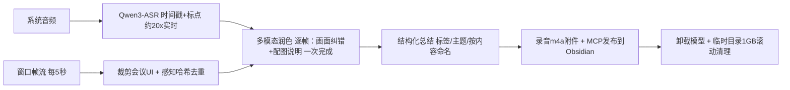

# meeting-to-obsidian

[](LICENSE)
-black)

把在线会议（腾讯会议等，任何会上可见的会议应用）自动整理成结构化 **Obsidian 笔记**——全程本地推理，Apple Silicon 专用。

英文说明：[README.md](README.md)

## 它做什么



- **遮挡免疫的捕获**：SCStream 常驻订阅会议窗口的视频输出（不是截屏），前面有其他窗口也不影响；Retina 原生 2x 分辨率，内置逐帧 MD5 去重
- **录系统音频，不录麦克风**：录的是会议应用播放的声音（ScreenCaptureKit），参会人可以正常外放听会
- **单 ASR 模型**：Qwen3-ASR-1.7B（MLX）一次输出转录、标点和逐句时间戳（约 20 倍实时）；whisper-large-v3-turbo 仅作故障回退
- **多模态润色**：每张关键帧 + 该时段语音一起交给本地视觉语言模型（Qwen3.6-35B-A3B，MLX server），一次调用完成两件事——**用幻灯片上的文字纠正 ASR 同音字/术语错误**，并为该页生成直接陈述式配图说明
- **干净的产出**：kepano 风格笔记（属性：主题/时长/标签/作者/录音链接 + 图文对照 + 结构化总结 + 全文转录）；录音压缩为 64k AAC 附件；笔记按会议内容自动命名；处理完自动卸载模型、临时目录超 1GB 滚动清理

## 环境要求

- macOS + Apple Silicon（M1 起，M4 Pro 实测）
- Xcode 命令行工具（`swiftc`）
- Python 3.10+、`ffmpeg`（`brew install ffmpeg`）
- [Obsidian](https://obsidian.md)（`scripts/obsidian_mcp_client.py` 所需的 MCP 端点）
- 可选回退后端：[ollama](https://ollama.com) + `qwen2.5:7b`

## 快速开始

```sh
git clone https://github.com/fbica2gh/meeting-to-obsidian.git
cd meeting-to-obsidian
./install.sh
```

`install.sh` 会生成配置（`~/.zcode/config/meeting-to-obsidian/`）、编译 Swift 辅助程序、创建带 MLX 依赖的 Python venv，并给出模型下载命令。

然后编辑 `~/.zcode/config/meeting-to-obsidian/config.sh`（vault 路径等），开始录制：

```sh
WID=$(swift scripts/find_tencent_window.swift)
SESSION="$HOME/Meetings/$(date +%Y-%m-%d_%H%M%S)"; mkdir -p "$SESSION"

scripts/system_audio_capture "$SESSION/audio.wav" &
echo $! > "$SESSION/audio.pid"
nohup bash -c 'while true; do W=$(swift scripts/find_tencent_window.swift); \
  scripts/window_stream "$W" '"$SESSION"' 5; sleep 2; done' &
echo $! > "$SESSION/screenshot.pid"

# 每 5 分钟增量转录一段；停止捕获后自动生成笔记
nohup bash scripts/incremental_watch.sh "$SESSION" "" "我的会议" &
echo $! > "$SESSION/watch.pid"
```

会议结束后停止捕获进程（或 `scripts/stop_capture.sh "$SESSION"`），增量监听会自动完成笔记。

## 模型权重

权重**不随仓库分发**；`scripts/parallel_download.py` 从 ModelScope / Hugging Face 多线程下载（严格 Range 校验 + SHA256 验证）：

| 模型 | 用途 | 许可 |
|-------|------|---------|
| [Qwen3-ASR-1.7B](https://www.modelscope.cn/models/mlx-community/Qwen3-ASR-1.7B-bf16) | 转录主力 | Apache-2.0 |
| [Qwen3.6-35B-A3B-4bit](https://www.modelscope.cn/models/mlx-community/Qwen3.6-35B-A3B-4bit) | 多模态润色 | Apache-2.0 |
| [whisper-large-v3-turbo](https://huggingface.co/openai/whisper-large-v3-turbo)（可选回退） | 转录备用 | MIT |

完整依赖许可清单见 [THIRD-PARTY-NOTICES.md](THIRD-PARTY-NOTICES.md)。

## 配置

`~/.zcode/config/meeting-to-obsidian/config.sh`（由 `config.example.sh` 生成）：

| 变量 | 用途 | 默认 |
|------|------|------|
| `OBSIDIAN_VAULT` | 笔记写入的 vault 根目录 | `~/Documents/Obsidian Vault` |
| `CAPTURE_ROOT` | 录制根目录 | `~/Downloads/TencentMeeting` |
| `MODELS_DIR` | MLX 权重目录 | `~/.zcode/models` |
| `GLOSSARY_FILE` | 术语词典（每行 `错误写法=正确写法`） | 配置目录 |
| `KEEP_MLX_SERVER` | `1` = 处理完不卸载模型 | `0` |

词典在两处生效：纠错前的确定性替换，以及 ASR 阶段的热词偏置（context biasing）。把公司/产品/领域名词喂进去，是最便宜的质量提升。

## 性能基线

M4 Pro / 48GB 实测，约 19 分钟的会议：

| 阶段 | 耗时 |
|-------|------|
| 转录（Qwen3-ASR，分块+并行） | ~53 秒（≈20x 实时） |
| 帧裁剪+去重（219 → 26 帧） | ~30 秒 |
| 多模态润色+总结+标签+主题 | ~35 秒 |
| 录音压缩+发布 | ~5 秒 |
| **散会后总耗时** | **约 100 秒** |

## 故障排查

[SKILL.md](SKILL.md) 末尾的表格记录了全部踩坑经验：全屏窗口的冻结帧、像素 stride 错位、感知哈希阈值、iCloud 模型加载卡死、mlx-vlm 与 mlx-lm 的运行时选择、提示词模板的花括号坑等。

## 许可与声明

代码以 [MIT](LICENSE) 许可开源。第三方组件与模型权重保留各自许可——模型权重在运行时下载，本仓库**不包含、不再分发**。录制会议涉及他人语音与屏幕内容，请确保参会方知情同意，并遵守会议软件的服务条款。详见 [THIRD-PARTY-NOTICES.md](THIRD-PARTY-NOTICES.md)。
