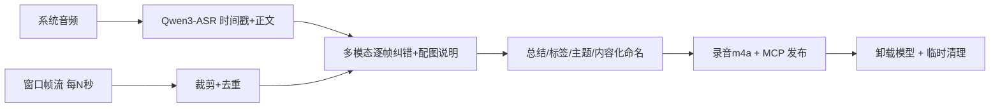

# 会议 → Obsidian 笔记

> 完整文档与安装说明见 [README.zh-CN.md](README.zh-CN.md)（英文：[README.md](README.md)）。

在线会议（腾讯会议等）自动记录为结构化 Obsidian 笔记：**画面帧流 + 系统音频 → 单模型转录 → 多模态纠错/总结 → 图文笔记**。

## 核心架构

| 能力 | 实现 |
|------|------|
| 窗口画面捕获 | `window_stream`：SCStream 常驻订阅窗口视频帧（遮挡免疫、Retina 原生 2x、内置 MD5 帧级去重、可设间隔） |
| 系统音频捕获 | ScreenCaptureKit `SCStream` + `capturesAudio`（与麦克风无关，用户仍可正常外放） |
| 语音转录 | **Qwen3-ASR-1.7B（MLX）**：时间戳 + 标点 + 正文一次输出，~20x 实时，长音频自动切块；whisper-large-v3-turbo 仅作故障回退 |
| 多模态润色 | **每张关键帧 + 该时段转录 → 一次调用**：用幻灯片画面纠正 ASR 术语错误，并生成直接陈述式配图说明；分章节要点总结、主题标签、一句话主题 |
| 关键帧去重 | 16×16 感知哈希（aHash+dHash），阈值 12 |
| 主题切分 | **确定性算法**：逐页配图说明 → nomic-embed 嵌入 → 相邻滑窗余弦相似度深谷 = 主题边界（谷深阈值 0.08）；LLM 仅负责给每段命名。同一主题的阶段划分（演示/案例/总结）不会产生深谷，天然不误拆；多主题时拆成多份笔记 |
| 输出 | 每份笔记 = 属性（主题/时长/标签/作者）+ 整场录音 m4a + 图文对照（**每页 PPT 配对应时段录音片段 `clips/seg_*.m4a`，与讲解原文一一对应**）+ 结构化总结 + 全文转录 |
| 资源管理 | 处理完自动卸载 MLX server/ollama 模型；临时目录 >1GB 滚动清理；录音压缩为 m4a 附件 |



## 安装与配置

### 1. 拷贝配置（个人路径与词表不随 skill 分发）

```sh
mkdir -p ~/.zcode/config/meeting-to-obsidian
cp <skill>/config.example.sh ~/.zcode/config/meeting-to-obsidian/config.sh
cp <skill>/glossary.example.txt ~/.zcode/config/meeting-to-obsidian/glossary.txt
```

按需修改 `config.sh`：

| 变量 | 说明 | 默认 |
|------|------|------|
| `OBSIDIAN_VAULT` | 笔记写入的 vault 根目录 | `~/Documents/Obsidian Vault` |
| `CAPTURE_ROOT` | 录制文件根目录 | `~/Downloads/TencentMeeting` |
| `MODELS_DIR` | MLX 模型目录 | `~/.zcode/models` |
| `GLOSSARY_FILE` | 术语词典（错误写法=正确写法） | 配置目录下 glossary.txt |
| `KEEP_MLX_SERVER` | 1=处理完不卸载模型 | 0 |

### 2. 编译 ScreenCaptureKit 辅助程序

```sh
bash <skill>/scripts/build_swift.sh
```

生成 `window_capture` / `window_stream` / `display_capture` / `system_audio_capture`，首次运行需授予「屏幕录制 / 系统音频录制」权限。

### 3. 准备模型（MLX 格式）

| 模型 | 用途 | 获取 |
|------|------|------|
| `Qwen3-ASR-1.7B` | 转录主力 | `parallel_download.py --repo mlx-community/Qwen3-ASR-1.7B-bf16 --file model.safetensors --dest $MODELS_DIR/Qwen3-ASR-1.7B --size 4076186653` |
| `Qwen3.6-35B-A3B-4bit` | 多模态润色（OpenAI 兼容服务） | 同上思路，按仓库文件清单下载全部文件并 SHA256 校验 |
| `whisper-large-v3-turbo`（可选回退） | 转录备用 | 同上 |

Python 依赖（`~/.zcode/venvs/whisper` 或自建 venv）：`mlx mlx-audio mlx-vlm mlx-whisper pillow`；后处理回退系使用 ollama + `qwen2.5:7b`。

## 使用

### 实时捕获 + 增量转录（推荐）

```sh
# 1) 找窗口 ID
WID=$(swift scripts/find_tencent_window.swift)

# 2) 录画面（每 5 秒一帧）+ 系统音频
SESSION=$CAPTURE_ROOT/$(date +%Y-%m-%d_%H%M%S); mkdir -p "$SESSION"
scripts/system_audio_capture "$SESSION/audio.wav" &
nohup bash -c 'while true; do W=$(swift scripts/find_tencent_window.swift); scripts/window_stream "$W" '"$SESSION"' 5; sleep 2; done' &
echo $! > "$SESSION/screenshot.pid"; echo $! > "$SESSION/audio.pid"

# 3) 增量转录（会议中每 5 分钟自动转一片，散会即出笔记）
nohup bash scripts/incremental_watch.sh "$SESSION" "" "会议标题" &

# 4) 会议结束后停止捕获（或用 stop_capture.sh），增量监听会自动生成笔记
```

### 事后处理已有录制

```sh
bash scripts/process_live.sh <捕获目录> [vault] [标题] [--meta meta.json]
bash scripts/process_meeting.sh <meeting.mp4> [vault] [标题] [--meta meta.json]
```

`--meta` 支持 `title/date/authors/location/organizer/theme/agenda/guests`；`authors` 会写入笔记属性与「主讲人」。

## 输出结构

```
<vault>/
├── 会议笔记/
│   └── <按内容自动命名>.md     # 属性(主题/时长/标签/作者) + 录音链接 + 图文对照 + 总结 + 全文
└── attachments/<同名>/
    ├── audio.m4a               # 录音（64k AAC）
    └── frame_*.png             # 关键帧
```

## 关键脚本

| 脚本 | 作用 |
|------|------|
| `build_swift.sh` | 编译+签名 SCK 辅助程序 |
| `find_tencent_window.swift` | 查找会议窗口 ID（取最前面的窗口） |
| `window_stream` | 常驻帧流（窗口视频输出，遮挡免疫） |
| `display_capture` | 显示器捕获（备用） |
| `system_audio_capture` | 系统音频录制（16k 单声道 WAV） |
| `incremental_watch.sh` | 增量流水线：分片转录 → 散会出笔记 |
| `process_live.sh` / `process_meeting.sh` | 捕获目录 / 视频文件 → 笔记 |
| `qwen_asr_transcribe.py` | Qwen3-ASR 转录（时间戳+正文，长音频分块） |
| `polish_note.py` | 多模态逐帧纠错+配图说明、总结、标签、主题 |
| `generate_note.py` | 生成 kepano 风格笔记（属性/图文对照/录音链接） |
| `mlx_server.sh` | MLX server 管理（start/stop/status；多模态自动选 mlx_vlm 运行时） |
| `crop_borders.py` / `dedup_images.py` | 会议 UI 裁剪 / 感知哈希去重 |
| `cleanup_tmp.py` | 临时目录 1GB 滚动清理 |
| `obsidian_mcp_client.py` | MCP 发布 |
| `parallel_download.py` | 多源分片下载（严格 Range 校验，拉 MLX 权重） |
| `benchmark_asr.sh` | ASR 横向实测 |

## 故障排查

| 症状 | 原因 | 解决方案 |
|------|------|----------|
| 音频全静音（-91dB） | 缺 `NSAudioCaptureUsageDescription` 或输出对象被释放 | 用 `build_swift.sh` 重新编译（内嵌 Info.plist + 强引用修复） |
| 截图全部相同 | 窗口截图对全屏窗口会返回冻结帧 | 用 `window_stream` 常驻帧流（直接读窗口视频输出） |
| 截图被前面窗口遮挡 | 显示器捕获会截进前置窗口 | 同上，窗口帧流遮挡免疫 |
| 帧流画面斜切错位 | 像素缓冲手动 memcpy 忽略 stride | 已用 VTCreateCGImageFromCVPixelBuffer 直接转换 |
| 关键帧只剩几张 | 8×8 哈希 + 阈值 30 误判同模板页为重复 | 已改 16×16 哈希 + 阈值 12 |
| 转录忽快忽慢/超时 | 模型放在 iCloud 目录被驱逐后拉取超时 | 模型放本地磁盘（`MODELS_DIR`） |
| 模型下载后推理乱码 | 并行下载分片零填充 | 用 `parallel_download.py`（校验 206/Range）+ SHA256 校验 |
| Qwen3.6 报 `empty prompt` | 该代是原生多模态，需 mlx-vlm，且仓库文件要齐（tokenizer*.json 等） | 用 mlx-vlm；下载后核对仓库文件清单 |
| 配图说明为空 | 提示词模板 `{}` 被 `.format()` 当占位符 | 模板用 `@HINT@/@CHUNK@` 占位符替换 |
| 长会议中后段讲解原文与幻灯片对不上 | 分块转录的时间偏移按"分段最大end"累计，每块尾段静音造成数秒误差、越漂越大 | 偏移按 ffmpeg 分块的精确边界 `i*MAX_CHUNK_SEC` 计算 |
| 润色后转录内容明显变短（丢半） | 视觉纠错被模型"顺手"概括成了摘要 | 提示词强调逐句保真 + 输出长度 <80% 时回退原切片 + 视觉输出后再过一遍词典终检 |
| shell 报变量未定义（含中文） | `$VAR（` 中文字符粘进变量名 | 用 `${VAR}（` |

## 注意事项

1. **首次授权**：`window_stream` / `system_audio_capture` 需授予屏幕录制/系统音频录制权限
2. **词表积累**：把每场会议的专有名词错误（公司/产品/技术术语）补进 `GLOSSARY_FILE`，确定性替换 + ASR 热词偏置双重生效
3. **录音附件**：处理完成时自动生成 `audio.m4a`（64k 单声道，约 1/4 体积）并写入「▶ 会议录音」链接
4. **资源回收**：处理完自动卸载 MLX server 与 ollama 模型（`KEEP_MLX_SERVER=1` 可保留）、临时目录超 1GB 滚动清理
5. **性能基线**（M4 Pro 48GB）：Qwen3-ASR ≈20x 实时；Qwen3.6-35B-A3B ≈51-53 tok/s（文本）/ 每帧约 3.3s（视觉）；19 分钟会议会后处理约 100 秒
